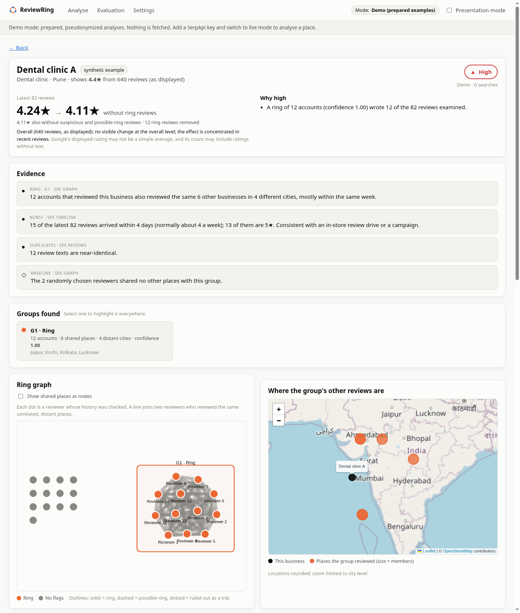
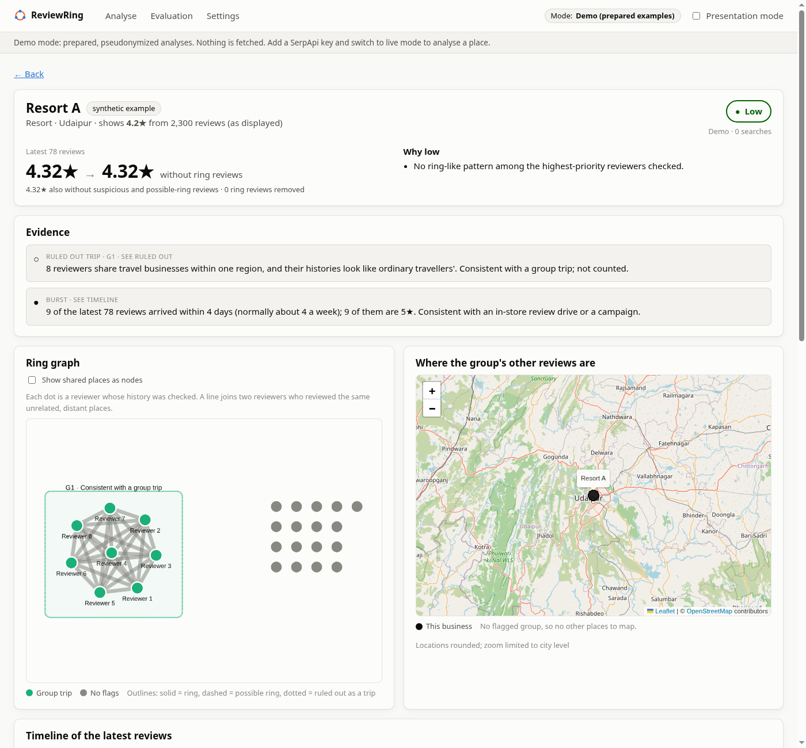
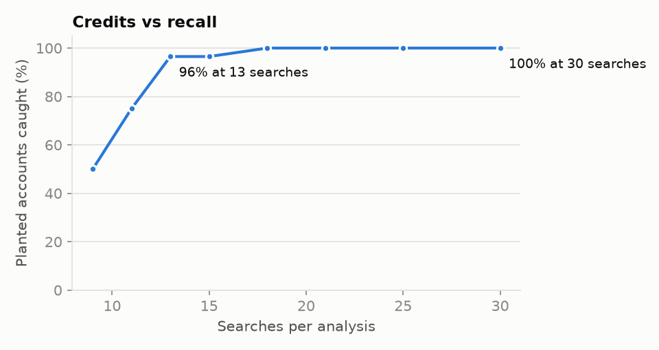

# ReviewRing

**A Google rating is a number. ReviewRing shows where it comes from.** Paste a Google Maps link and ReviewRing reads the newest 100 reviews, marks the ones that carry a warning sign, and shows you the rating without them. You choose which signs to set aside; every sign comes with its evidence, and nothing is ever called fake.

The warning signs, strongest first:

| Sign | What it means | At first |
|---|---|---|
| **Chatbot or template text** | The review says "I'm unable to generate a review for you…" or "[Hotel Name]" | Set aside |
| **Copied text** | Near-identical to a review another account wrote | Set aside |
| **First-time accounts in a burst** | Posted in a sudden burst of 5★ reviews from accounts that have reviewed nothing else | Set aside |
| **Linked reviewer group** | The reviewer is one of a group of accounts that reviewed the same unrelated businesses in distant cities | Set aside |
| **Reads as AI-written** | An AI model's opinion, with the phrases it quotes as the reason. Only reviews of 40+ words are judged | Kept |
| **Reviewing spree** | The reviewer rated many businesses in several cities within a month, nearly all 5★ | Kept |
| **First-time account** | The account shows no other reviews. Many real customers do this, so it's context only | Kept |

Each review is drawn as a dot that flows down a branching graph and stops at the first sign the reader has set aside; the rest reach **Kept**, with their own average. Around that, the report shows a rating carried by old reviews (4.9★ displayed while recent guests average 3.3★), five-star reviews concentrated among first-time accounts, waves of prompted reviews (shown as context, never as a red flag) and every reviewer history that was opened.



*SerpApi India Hackathon 2026 · Knowledge & Public Interest track · MIT licensed*

## What we found on real listings

We tested ReviewRing on real Google Maps listings in Bengaluru and Delhi (about 100 SerpApi searches). The manipulation we found was cheaper than we expected:

- **Burner accounts:** a mover rated 5.0★ received 31 five-star reviews in 3 days; 27 came from accounts that have never reviewed anything else.
- **Chatbot text:** a budget hotel showing 4.9★ from thousands of reviews, whose latest 88 reviews average 3.3★, had a 5★ review reading *"I'm unable to generate a review for you, but I can help you outline key points."*
- **A reviewing spree:** one of that hotel's reviewers rated a dozen hotels in six cities within a month, all 5★.
- **No rings in this sample.** Even an account that looked like a "rate hotels and earn" task worker (12 hotels in 6 cities in one month, all 5★) shared no hotels with other reviewers. In those scams the hotels are decoys and each worker gets a different list, so the linked-group check stays in the product but isn't the headline.
- **Reviews that look like a campaign but aren't one:** a mover whose reviews arrive in waves was rated Low, because the reviewers' full histories showed established local people. The business was asking customers to review, not buying reviews.

Listings are not named here; the tool reports patterns, not verdicts.

What this taught us: most manipulation is cheap and one review at a time, so a single first-time account proves nothing (most real customers in India review once). The pattern shows up in aggregate (first-time accounts arriving in a burst, or concentrated among the 5★ reviews), which is the singleton-review insight of Xie et al. (KDD 2012). That's why ReviewRing now judges each review by its signs and lets the reader filter, instead of leading with rings.

## The problem

People in India pick clinics, hotels, coaching centres, packers-and-movers and restaurants by their Google rating. That rating is distorted by paid review farms, and by the "rate hotels on Google Maps and earn" **task scams**, which recruit ordinary people to post 5★ reviews in batches (see [The Metrognome](https://www.themetrognome.in/business-and-personal-finance/are-you-receiving-data-entry-job-offers-its-likely-an-online-scam) and a [₹9.68 lakh task-fraud case reported by Deccan Herald](https://www.deccanherald.com/amp/story/india%2Fmaharashtra%2Ffour-held-for-cheating-media-executive-of-rs-968-lakh-in-task-fraud-in-mumbai-2691525)).

A single bought review is indistinguishable from a real one. The pattern only appears in aggregate: when the reviews arrived, who wrote them, what else those accounts have reviewed, and whether the recent reviews agree with the displayed rating.

## How it works

1. **Newest reviews.** Fetch the business's newest 100 reviews (6 pages) with their exact dates, texts and each reviewer's review count. Check them for chatbot phrases, copied text, bursts of first-time accounts and a rating that sits far above them.
2. **Reviewer histories.** Fetch the full public history of the 8 highest-priority reviewers plus 2 random baseline reviewers. If none of them share anything, stop there. Otherwise fetch 15 more. Histories show reviewing sprees and linked groups.
3. **Co-review graph.** Link two reviewers when they reviewed at least two of the same *unrelated, distant* places, weighted by distance from the business and by how unusual the place type is. Tight groups that span distant cities are ring-like; **friends and family** and **group trips** with positive evidence are set aside, never counted.
4. **AI-written opinion (optional).** With a DeepSeek key, reviews of 40 words or more are read for AI-written style. An "AI-written" opinion only counts when it quotes at least two phrases that are really in the review. Shorter reviews aren't judged: detectors are unreliable on short texts and over-flag people writing in a second language.
5. **Sort the reviews.** Every review gets all the signs that apply. The report draws the newest 100 as dots that leave a trunk at the first sign the reader sets aside, so the reader sees exactly which reviews each choice removes and what the rest average. Below it, the kept reviews (and each set-aside branch) are listed with their signs, and the quoted AI phrases underlined.

| Ring graph and map | A group trip, ruled out |
|---|---|
|  |  |

> Screenshots come from the synthetic demo fixtures. *(TODO before submission: replace them with a real showcase recorded in presentation mode, and add the report GIF.)*

A **Chrome extension** puts a badge on Google Maps place pages and opens a side panel. Paste a Maps link there (or open a place), click **Check reviews**, tick the signs to set aside, and read the reviews you kept with their rating.

Everything that decides (signs, labels, groups, levels, ratings) is deterministic and explained in [docs/methodology.md](docs/methodology.md). The optional AI model (DeepSeek) does two things, neither of which raises the level: it gives the "reads as AI-written" opinion described above, and writes a plain-language summary from numbered facts, under the evidence. A validator rejects any summary with a number, place name or loaded word it wasn't given.

## Why this needs SerpApi

ReviewRing can't exist without SerpApi. Google's official Places API returns **at most 5 reviews per place** and **no reviewer histories**. The reviewer history is the whole method.

| SerpApi engine | What ReviewRing uses it for |
|---|---|
| **Google Maps Contributor Reviews API** (`google_maps_contributor_reviews`) | A reviewer's public review history (up to 200 reviews, one search): what else they reviewed, where and when. It tells apart real customers (ordinary local lives) from linked groups and dormant accounts woken up for one review. |
| **Google Maps Reviews API** (`google_maps_reviews`) | The newest reviews, with exact dates and each reviewer's review count (bursts, single-use accounts, near-duplicate and chatbot text), and, sorted by highest rating, the old reviews that carry a listing's rating. |
| **Google Maps API** (`google_maps`) | Resolving a CID, a place_id-only link or a name search; the business's coordinates when no history contains them. |
| **Account API** (free) | The remaining monthly and hourly budget, shown before every analysis. |

When we checked (2026-09-26), none of the ~177 public BuiltWithSerpApi projects used the Contributor Reviews API.

## Quick start

Requires Python 3.12+ and Node 20+. [uv](https://docs.astral.sh/uv/) is recommended; a plain pip route is below.

### Demo mode (no keys, no network)

```bash
git clone https://github.com/kruxarth/serpapi-hackathon.git reviewring && cd reviewring
(cd web && npm install && npm run build)
cd backend && uv sync && uv run reviewring serve
# open http://127.0.0.1:8765
```

Without a SerpApi key the app starts in **demo mode**: prepared, pseudonymized analyses from `fixtures/`, re-run through the same engine and served by the same API.

<details><summary>Without uv (pip)</summary>

```bash
cd backend
python3 -m venv .venv && . .venv/bin/activate
pip install -r requirements.txt
reviewring serve
```
</details>

### Live mode (your own SerpApi key)

```bash
cp .env.example .env        # add SERPAPI_API_KEY (and optionally DEEPSEEK_API_KEY)
cd backend && uv run reviewring serve
```

Paste a Google Maps link and click **Check reviews**. A check costs about 16 SerpApi searches for a clean business and about 31 for one whose first reviewers turn out to be linked; the budget and caps are under **Settings** (people using the app don't need to think about searches). Everything fetched is cached, so re-opening or re-checking a place is free. Add `DEEPSEEK_API_KEY` for the AI-written opinion; without it that check is skipped and says so.

The same pipeline runs from the command line: `uv run reviewring --help` (`budget`, `dry-run`, `collect`, `resume`, `analyze`, `export`, `evaluate`, `purge-data`).

### Chrome extension

```bash
cd extension && npm install && npm run build
```

Then open `chrome://extensions`, enable Developer mode, click **Load unpacked** and pick `extension/dist`. Keep the backend running. The extension only ever talks to your local backend.

## Evaluation

`uv run reviewring evaluate` plants synthetic rings into clean businesses, replays the budgeted collection (priority score, round 1, early stop, round 2), and runs the engine on exactly what would have been fetched. It uses zero searches, fixed seeds and no AI. Results: [docs/evaluation/results.md](docs/evaluation/results.md).



- Recall is reported **split by where each missed account was lost**: not chosen by the priority score, chosen but not grouped, or grouped but failing the ring rules.
- **Negative scenarios** must not be flagged: a wedding party, a family trip, a tour through two nearby states, a local circle of friends.
- A **harder-rings** table (aged accounts with photos and unique texts) shows where the method loses.
- **Honesty:** the planted rings follow our own model of a ring, so recall on them is optimistic. The false-positive estimate uses a small sample and comes with its 95% interval.

## Search efficiency

- **~16 searches** for a clean business (6 review pages + 10 histories), thanks to the early stop; **~31** when the first reviewers are linked; a hard cap of 36. Search counts are a developer concern, so the app shows them only under Settings and in a "For developers" section of each report.
- Every raw response is cached before it's parsed; a forced refresh adds a new version instead of overwriting.
- A budget guard enforces the monthly, hourly and per-analysis caps (the stricter of the local ledger and SerpApi's Account API) and pauses at the hourly limit. Resuming never requests anything twice.
- `dry-run` lists exactly which requests an analysis would make, from the cache alone.

## Responsible use, limitations and privacy

- **A pattern, not proof.** ReviewRing says "suspicious", "coordinated" or "ring-like pattern", never "fake" or "fraud", and it never declares a business or a person dishonest. Every claim links to visible evidence.
- **It doesn't flag everything.** Friends, families and group trips are set aside and shown as such, and "not checked" reviewers are neutral. A first-time account and an AI-written opinion are kept unless the reader chooses otherwise.
- **The AI-written opinion is an opinion.** It's never counted towards the level, it must quote its evidence, and short reviews aren't judged.
- **A business can be targeted without its knowledge.** Review-task scams hand recruits real businesses to review, so a ring-like group says nothing about whether the business asked for it.
- **Known limits:** rings within a single city aren't detected; colleagues who stay at the same hotels in several cities can look ring-like; regional travel-only rings show at most as "possible ring (trip-like)"; only the newest 100 reviews and 25 reviewers are examined; private profiles can't be checked; Google may already have removed some reviews.
- **The AI never decides.** The summary sees pseudonymized facts only. The AI-written check sees review texts scrubbed of links, phone numbers, emails, handles and the business's name, never reviewer names or ids. Neither sets a label, group, level or rating.
- **Privacy.** The local cache in `data/` holds personal data and is never committed (`uv run reviewring purge-data --yes` deletes it). Committed fixtures are pseudonymized (salted ids, "Business A/B", areas only, coordinates rounded to ~11 km, an approximate review count, every date shifted by a hidden per-business offset, review text dropped unless it's a truncated template shared by 3+ accounts) and pass a leak check. **Presentation mode** pseudonymizes the live app for recordings. Keys stay in `.env` and the backend and are redacted from every log. The backend binds to 127.0.0.1 and rejects cross-site requests.

## Project layout

| Path | Contents |
|---|---|
| `backend/` | Python package: SerpApi gateway, parsers, engine, API, exporter, evaluation, tests |
| `web/` | React + Vite + TypeScript app |
| `extension/` | Chrome extension (Manifest V3) |
| `fixtures/` | Pseudonymized analyses for demo mode |
| `config/reviewring.toml` | Every tunable threshold in one file |
| `docs/` | Methodology, evaluation, decisions, QA checklists |

Contributing: `pre-commit install` runs gitleaks and the fixture leak check on every commit. Tests (`uv run pytest` in `backend/`) never touch the network; any attempt fails the run.

## Hackathon details

- **Track:** Knowledge & Public Interest
- **AI tools used:** Claude Code (implementation, with a human-written spec and review); DeepSeek inside the product, optionally, for the plain-language summary only.
- **License:** MIT
