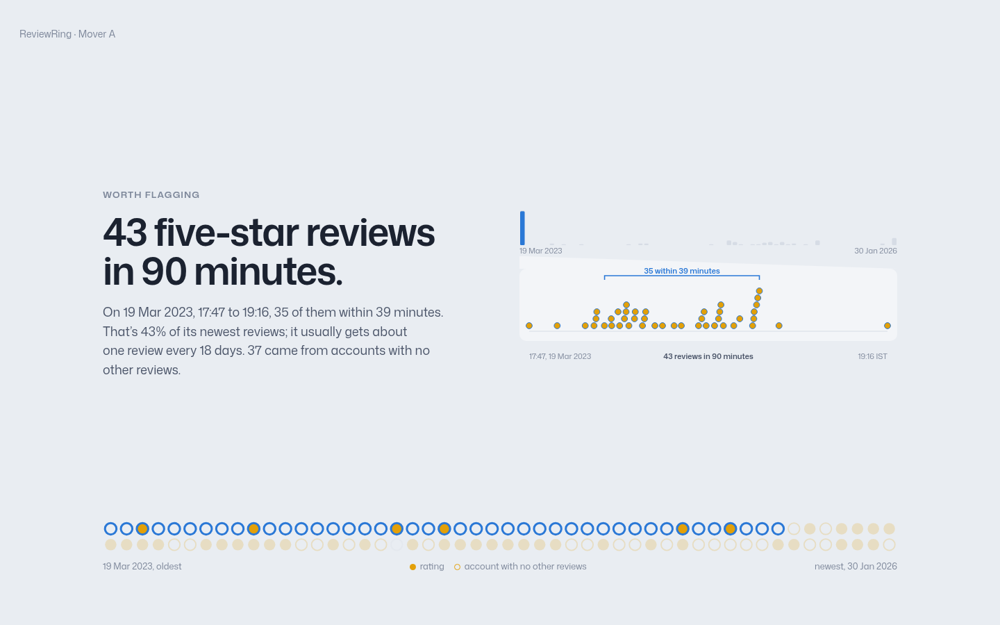
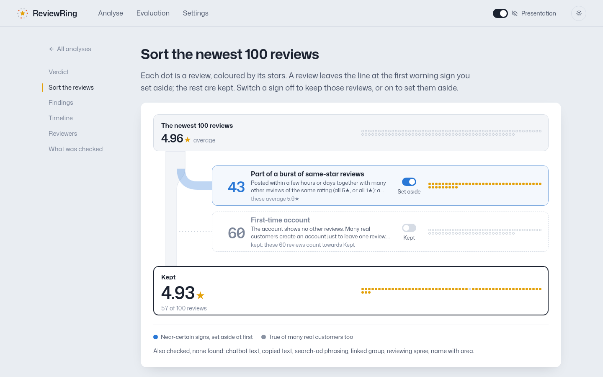

# ReviewRing

**A Google rating is a number. ReviewRing shows where it comes from.**

Paste a Google Maps link. ReviewRing reads the newest 100 reviews, marks the ones that carry a warning sign, and shows the rating without them. You choose what to set aside, every sign comes with its evidence, and nothing is ever called fake.

*SerpApi India Hackathon 2026 · Knowledge & Public Interest track · MIT licence*


| A report | Its one-minute walkthrough |
|---|---|
|  |  |

*Real listing, shown in presentation mode (names and dates pseudonymized).*

## What it looks for

| Sign | What it means | At first |
|---|---|---|
| **Review burst** | Many 5★ (or 1★) reviews packed into hours or days: a quarter or more of the newest reviews, far faster than the listing's usual pace | Set aside |
| **Copied text** | Near-identical to another account's review; the report shows both, shared words underlined | Set aside |
| **Search-ad phrasing** | "Best packers and movers in [area]": the bare search term, repeated across accounts | Set aside |
| **Chatbot text** | "I'm unable to generate a review for you…", "[Hotel Name]" | Set aside |
| **Linked reviewer group** | Accounts that reviewed the same unrelated businesses in distant cities (a "review ring") | Set aside |
| Reviewing spree, first-time account, name with area | True of many real customers too | Kept |

We set out to find review rings. ReviewRing opens reviewers' full histories and tests for them (after ruling out friends, families and group trips), but none showed up in our real sample; the ring example in demo mode is synthetic. What we did find was cheaper: bursts, templates and ad copy.



## Quick start

Requirements: **Python 3.12+**, **Node 20+**, [**uv**](https://docs.astral.sh/uv/) (or pip, below), and Chrome for the extension.

### 1. Demo mode: no API key, no network (about 2 minutes)

```bash
git clone https://github.com/kruxarth/serpapi-hackathon.git reviewring && cd reviewring
(cd web && npm install && npm run build)
cd backend && uv sync && uv run reviewring serve
```

Open **http://127.0.0.1:8765**. Without a SerpApi key the app starts in demo mode with six prepared examples (a ring, a burst of first-time accounts, a rating carried by old reviews, scripted reviews, a regional group, a family trip that is ruled out), run through the same engine and API as live mode.

<details><summary>Without uv (pip)</summary>

```bash
cd backend
python3 -m venv .venv && . .venv/bin/activate
pip install -r requirements.txt
reviewring serve
```
</details>

### 2. Live mode: check any place on Google Maps

```bash
cp .env.example .env          # put your key in SERPAPI_API_KEY
cd backend && uv run reviewring serve
```

Paste a Google Maps place link (long links, `maps.app.goo.gl` and `share.google` share links, or a name and city) and click **Check reviews**.

- A check costs about **16 searches** (6 review pages + 10 reviewer histories), and up to ~31 when the first reviewers turn out to be linked. The free SerpApi plan has 250 a month; **Settings** shows what's left.
- Everything fetched is cached, so reopening or re-checking a place costs nothing.
- `DEEPSEEK_API_KEY` in `.env` is optional: it only writes a plain-language summary. Without it the summary comes from templates.

### 3. Chrome extension

```bash
cd extension && npm install && npm run build
```

Open `chrome://extensions`, turn on **Developer mode**, click **Load unpacked** and pick `extension/dist`. Keep the backend running. Open a place on Google Maps (or paste a link into the side panel), click **Check reviews**, tick the signs to set aside, and read the reviews you kept. The extension only talks to your local backend.

### 4. Tests

```bash
cd backend && uv run pytest -q && uv run ruff check .     # never touches the network
cd web && npx tsc -b && npm run build
```

The same pipeline runs from the command line: `uv run reviewring --help` (`budget`, `dry-run`, `collect`, `analyze`, `evaluate`, …).

### Troubleshooting

| Problem | Fix |
|---|---|
| Port 8765 is busy | `uv run reviewring serve --port 8770` |
| A `maps.app.goo.gl` link takes ~20 s | Some ISPs block goo.gl; ReviewRing falls back to secure DNS. The long `google.com/maps/...` link is instant. |
| "Reached its limit for new analyses" | The monthly or hourly search budget is used up; places already checked still open. |
| The page looks out of date after pulling | Rebuild the web app: `cd web && npm run build` |
| Want demo mode with a key set | Switch the mode under **Settings** |

## How it uses SerpApi

Google's own Places API returns at most 5 reviews per place and no reviewer histories, so the method depends on SerpApi:

| SerpApi API | What ReviewRing uses it for |
|---|---|
| Google Maps (`google_maps`) | Resolve a link, place ID or name to one listing |
| Google Maps Reviews (`google_maps_reviews`) | The newest 100 reviews with exact timestamps and each reviewer's review count (bursts by the minute, first-time accounts); Google's top-ranked reviews for a rating carried by old praise |
| Google Maps Contributor Reviews (`google_maps_contributor_reviews`) | The full public history of the most unusual reviewers plus a random baseline: linked groups, reviewing sprees, the same ad copy written for competing businesses |
| Account API | A free budget check before every run |

A check stops early when its first reviewers share nothing, every raw response is cached before parsing, and a budget guard enforces monthly, hourly and per-check caps.

## How it works

1. **Read** the newest 100 reviews and check each for chatbot phrases, copied text, search-ad phrasing and same-star bursts.
2. **Open** the histories of the 8 highest-priority reviewers plus 2 at random; if any share unrelated places, open up to 15 more.
3. **Link** reviewers who reviewed at least two of the same unrelated, distant places, and test each group against innocent explanations (trips, friends, families) before calling it ring-like.
4. **Sort** the reviews by sign; the report, the walkthrough and the extension show the rating with whatever you set aside.

Every decision is a fixed rule in [`config/reviewring.toml`](config/reviewring.toml), explained in [docs/methodology.md](docs/methodology.md). The optional AI writes only the summary. We tried AI judgements of writing style ("reads as AI-written", "not in the reviewer's own voice") and switched them off: on real reviews they mostly flagged honest customers writing in a second language.


*Synthetic example from demo mode. Evaluation on planted rings: [docs/evaluation/results.md](docs/evaluation/results.md) (`uv run reviewring evaluate`, zero searches).*

## Responsible use

- **A pattern, not proof.** ReviewRing says "suspicious" or "ring-like", never "fake" or "fraud". A business can be targeted without its knowledge.
- **It doesn't judge how people write.** Broken English, Hinglish or a review polished with AI is not a warning sign.
- **Local and private.** The backend binds to 127.0.0.1; keys stay in `.env`; the cache in `data/` is never committed (`uv run reviewring purge-data --yes` deletes it).
- **Limits:** only the newest 100 reviews and up to 25 reviewers are examined; rings within one city aren't detected; private profiles can't be checked.

## Project layout

| Path | Contents |
|---|---|
| `backend/` | Python: SerpApi gateway and cache, engine, API, CLI, tests |
| `web/` | React + Vite + TypeScript app |
| `extension/` | Chrome extension (Manifest V3, side panel) |
| `fixtures/` | Pseudonymized examples for demo mode |
| `config/reviewring.toml` | Every threshold in one file |
| `docs/` | Methodology, evaluation, decisions |

**AI tools used:** Claude Code for implementation; DeepSeek, optionally, inside the product for the plain-language summary only.
