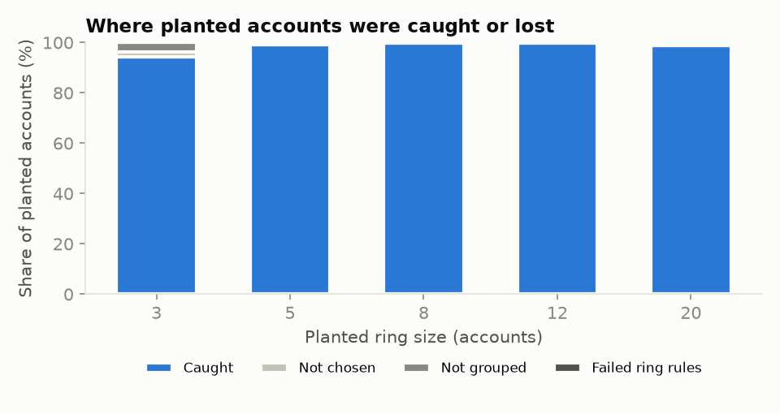

# Evaluation results

Algorithm version 0.1.0. Reproduce with `uv run reviewring evaluate` (fixed seeds, zero searches, no AI).

> Planted rings follow our own model of a ring, so recall on them is optimistic.

- **Bases:** synthetic-1 (Dental clinic, Pune), synthetic-2 (Restaurant, Bengaluru), synthetic-3 (Coaching center, Kolkata) (synthetic; no cached controls yet)
- **Recall on harder rings (aged accounts, photos, unique texts, spread timing):** 83.0% (249/300); almost every loss is at the priority step
- **Recall on rings shaped like our own model (optimistic):** 99.1% (5135/5184)
- **Lost: not chosen by the priority score:** 0.7%
- **Lost: chosen but not in any group:** 0.2%
- **Lost: grouped, but the group failed the ring rules:** 0.0%
- **Businesses with a planted ring rated High or Elevated:** 98.9%
- **False-positive rate on unplanted accounts:** 0/30 = 0.0% (95% Wilson interval 0.0%–11.4%; small sample)
- **Negative scenarios passed:** 6/6

## Recall by ring size (k)

| k | recall | not chosen | not grouped | failed rules | planted |
|---|---|---|---|---|---|
| 3 | 0.944 | 0.019 | 0.037 | 0.0 | 324 |
| 5 | 0.993 | 0.007 | 0.0 | 0.0 | 540 |
| 8 | 0.999 | 0.001 | 0.0 | 0.0 | 864 |
| 12 | 0.998 | 0.002 | 0.0 | 0.0 | 1296 |
| 20 | 0.989 | 0.011 | 0.0 | 0.0 | 2160 |

## Recall by shared places (m)

| m | recall | not chosen | not grouped | failed rules | planted |
|---|---|---|---|---|---|
| 2 | 0.992 | 0.007 | 0.001 | 0.0 | 1728 |
| 4 | 0.994 | 0.005 | 0.001 | 0.0 | 1728 |
| 8 | 0.986 | 0.009 | 0.005 | 0.0 | 1728 |

## Recall by camouflage

| camouflage | recall | not chosen | not grouped | failed rules | planted |
|---|---|---|---|---|---|
| none | 0.998 | 0.001 | 0.001 | 0.0 | 1728 |
| low | 0.991 | 0.008 | 0.001 | 0.0 | 1728 |
| high | 0.983 | 0.012 | 0.005 | 0.0 | 1728 |

## Recall by timing

| timing | recall | not chosen | not grouped | failed rules | planted |
|---|---|---|---|---|---|
| same day | 1.0 | 0.0 | 0.0 | 0.0 | 1296 |
| same week | 0.999 | 0.001 | 0.0 | 0.0 | 1296 |
| month | 0.987 | 0.008 | 0.005 | 0.0 | 1296 |
| unknown | 0.976 | 0.019 | 0.005 | 0.0 | 1296 |

## Regional travel-only rings (within ~450 km)

| base | k | as_ring | as_possible_trip | planted | level |
|---|---|---|---|---|---|
| synthetic-1 (Dental clinic, Pune) | 5 | 0 | 5 | 5 | Elevated |
| synthetic-1 (Dental clinic, Pune) | 8 | 0 | 8 | 8 | Elevated |
| synthetic-2 (Restaurant, Bengaluru) | 5 | 0 | 5 | 5 | Elevated |
| synthetic-2 (Restaurant, Bengaluru) | 8 | 0 | 8 | 8 | Elevated |
| synthetic-3 (Coaching center, Kolkata) | 5 | 5 | 0 | 5 | Elevated |
| synthetic-3 (Coaching center, Kolkata) | 8 | 8 | 0 | 8 | High |

## Harder rings: aged accounts, photos, unique texts, spread timing (information only)

| base | k | recall | not chosen | not grouped | failed rules | planted |
|---|---|---|---|---|---|---|
| synthetic-1 (Dental clinic, Pune) | 5 | 0.85 | 0.15 | 0.0 | 0.0 | 20 |
| synthetic-1 (Dental clinic, Pune) | 8 | 0.844 | 0.156 | 0.0 | 0.0 | 32 |
| synthetic-1 (Dental clinic, Pune) | 12 | 0.812 | 0.188 | 0.0 | 0.0 | 48 |
| synthetic-2 (Restaurant, Bengaluru) | 5 | 0.4 | 0.4 | 0.2 | 0.0 | 20 |
| synthetic-2 (Restaurant, Bengaluru) | 8 | 0.781 | 0.219 | 0.0 | 0.0 | 32 |
| synthetic-2 (Restaurant, Bengaluru) | 12 | 0.896 | 0.104 | 0.0 | 0.0 | 48 |
| synthetic-3 (Coaching center, Kolkata) | 5 | 0.8 | 0.2 | 0.0 | 0.0 | 20 |
| synthetic-3 (Coaching center, Kolkata) | 8 | 0.906 | 0.094 | 0.0 | 0.0 | 32 |
| synthetic-3 (Coaching center, Kolkata) | 12 | 0.938 | 0.062 | 0.0 | 0.0 | 48 |

## Negative scenarios (share of planted members flagged, by group size)

| scenario | kind | flagged (size 3) | flagged (size 5) | flagged (size 8) | result |
|---|---|---|---|---|---|
| Wedding party in one far city | must not be flagged | 0.0 | 0.0 | 0.0 | PASS |
| Family trip | must not be flagged | 0.0 | 0.0 | 0.0 | PASS |
| Tour through two nearby states | must not be flagged | 0.0 | 0.0 | 0.0 | PASS |
| Package tour with the guide's emporium | must not be flagged | 0.0 | 0.0 | 0.0 | PASS |
| Hometown friends reviewing a far resort | must not be flagged | 0.0 | 0.0 | 0.0 | PASS |
| Local circle of friends | must not be flagged | 0.0 | 0.0 | 0.0 | PASS |
| Thin solicited tourists, all 5★ (expected: possible, trip-like) | information only | 1.0 | 1.0 | 1.0 | - |
| Family support circle across cities (genuine coordination) | information only | 1.0 | 1.0 | 0.875 | - |
| Friends from several cities at two weddings | information only | 0.0 | 0.5 | 0.875 | - |
| Colleagues at the same hotels in several cities (known limit) | information only | 0.0 | 0.0 | 0.0 | - |

## Ablation: regional campaigns hidden by the trip rule

| trip rule | hidden as trip | shown as ring-like | planted |
|---|---|---|---|
| 2 of 3 indicators (old) | 0.778 | 0.0 | 36 |
| evidence required (current) | 0.0 | 0.778 | 36 |

## Clean bases without planted rings

| base | level | searches | early_stop |
|---|---|---|---|
| synthetic-1 (Dental clinic, Pune) | Low | 15 | True |
| synthetic-2 (Restaurant, Bengaluru) | Low | 15 | True |
| synthetic-3 (Coaching center, Kolkata) | Low | 15 | True |

## Credits vs recall (k=8, m=4, low camouflage, same week)

| histories | searches | recall |
|---|---|---|
| 4 | 9.0 | 0.5 |
| 6 | 11.0 | 0.736 |
| 8 | 13.0 | 0.944 |
| 10 | 15.0 | 0.944 |
| 13 | 18.0 | 1.0 |
| 16 | 21.0 | 1.0 |
| 20 | 25.0 | 1.0 |
| 25 | 30.0 | 1.0 |
